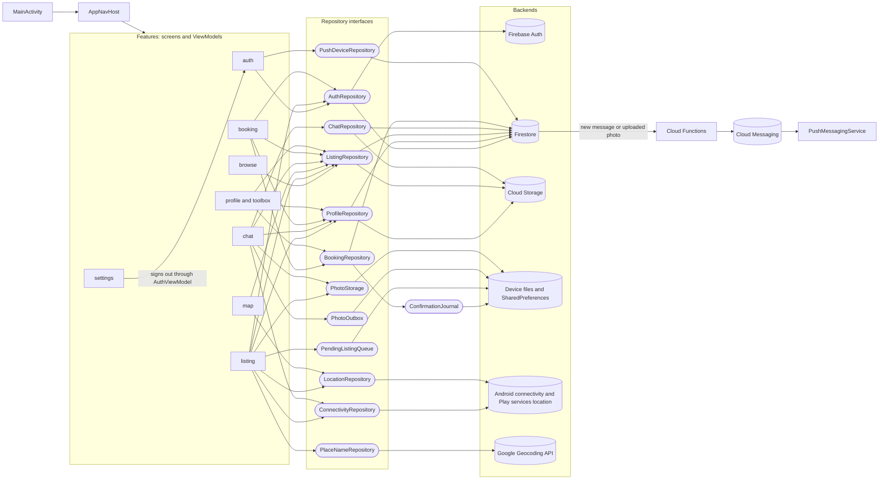

<!-- Co-authored-by: Claude Code (Claude Opus 5.5) -->
# Architecture

How PolyBazaar is put together, for teammates and agents starting a task. It names types and paths to search for rather than linking files, and keeps to what changes rarely. Update it in the same PR as a change that makes it wrong; `ArchitectureDocTest` fails when a package or a Firestore collection is missing, or when a type named here no longer exists.

## Overview

PolyBazaar is one Android app module (`app/`, package `com.android.polybazaar`) written in Kotlin with Jetpack Compose, plus a Firebase backend: Auth, Firestore, Storage, Cloud Messaging and the Cloud Functions in `functions/`. Students list items and skills, browse them in a list or on a map, message the owner, and book days. The app keeps working offline: Firestore caches reads and queues writes, and the app keeps its own queues on the device for what Firestore can't hold, such as photos.

The code is split by feature. Each feature package holds up to three layers: `model` (data classes, repository interfaces and their implementations), `viewmodel` and `ui` (composables). One activity, `MainActivity`, hosts every screen through Compose navigation.

## Diagram

Each feature box stands for its screens and ViewModels. Arrows show which repository interfaces they use, and what backs each interface.

## Code map

Feature packages under `app/src/main/java/com/android/polybazaar/`:

- **`auth/`**: sign-in, account creation, email verification and the forgot-password email. `AuthRepository` (`FirebaseAuthRepository`) owns the session and the `usernames` reservations. `AuthRules` and `isEpflEmail` validate the fields. `ViewerCache` keeps the signed-in `User` for one screen. ViewModels: `AuthViewModel` (shared by every auth screen; registers and unregisters this device for push), `ForgotPasswordViewModel`, `VerifyEmailViewModel`, `ResetPasswordViewModel`.
- **`browse/`**: the Browse tab, the marketplace list with search and filters. `BrowseViewModel`.
- **`listing/`**: creating, editing and showing a listing. `Listing` is sealed into `ItemListing` and `ServiceListing`. `ListingCategory` ids must match the category lists in `firestore.rules`. `ListingRules` validates the form, `ListingRepository` (`FirebaseListingRepository`) stores listings and their photos, `PhotoStorage` (`FilePhotoStorage`) keeps camera photos on the device until they are uploaded, in one folder per form (create, edit, and the conversation's composer), and `PendingListingQueue` (`FilePendingListingQueue`) keeps offline drafts. ViewModels: `ListingFormViewModel` (create and edit), `ListingDetailViewModel`, `ListingDraftPublisherViewModel`.
- **`map/`**: the Map tab. `MapViewModel` shows listings around the user's approximate location (`LocationRepository`, `FusedLocationRepository`) or a `Campus`. `PlaceNameRepository` (`GoogleGeocodingRepository`) suggests a town name for a listing located off campus. `AppNavHost` takes the map as a `MapSlot`, so tests can pass a stand-in where Google Maps can't run.
- **`chat/`**: the inbox and conversations, with photo messages. `ChatRepository` (`FirebaseChatRepository`). A conversation is per listing and renter, with the id `conversationId(listingId, renterUid)`. `ChatRules` validates messages. `PhotoOutbox` (`FilePhotoOutbox`) keeps photos sent offline. ViewModels: `InboxViewModel`, `ConversationViewModel`, `PhotoOutboxSenderViewModel`. `photoUploadScope` runs uploads for as long as the process lives.
- **`booking/`**: requesting days, the renter's bookings, and the requests an owner received. `BookingRepository` (`FirebaseBookingRepository`). `DateSelection.kt` holds the pure calendar logic. `ConfirmationJournal` (`SharedPreferencesConfirmationJournal`) records handover and return confirmations. ViewModels: `BookingRequestViewModel`, `BookingViewModel`, `ReceivedRequestsViewModel`.
- **`profile/`**: the Profile tab, editing it, and other users' profiles (`LenderProfileScreen`). `ProfileRepository` (`FirebaseProfileRepository`), `ProfileRules`. ViewModels: `ProfileViewModel`, `EditProfileViewModel`, `LenderProfileViewModel`.
- **`toolbox/`**: the owner's own listings on the Profile tab, each with a `ToolboxListingStatus` derived from its bookings. `ToolboxViewModel`.
- **`settings/`**: the settings screen, opened from the profile, where the user signs out.
- **`notification/`**: push notifications. `PushDeviceRepository` (`FirebasePushDeviceRepository`) stores this device under the user, and `PushMessagingService` receives FCM events.
- **`connectivity/`**: `ConnectivityRepository` (`AndroidConnectivityRepository`), whether the device is online.
- **`error/`**: `AppError`, the failures a user can be told about, and their messages (see Errors below).
- **`photo/`**: `JpegPhotoCompressor`, which shrinks every photo before upload (the repositories and `FilePhotoOutbox` use it), `rememberPhoto`, which decodes a downloaded photo for display, and the `photo.PhotoStorage` object with the JPEG metadata and the 10 MB cap that the Storage rules share. It is unrelated to `listing.model.PhotoStorage`.
- **`ui/`**: the app shell. `ui/navigation` holds `AppNavHost`, `Routes` and `AppBottomBar`, and `ui/theme` holds `PolyBazaarTheme`.

Other places:

- **`MainActivity`, `PolyBazaarApplication`**: the composition root (see Wiring).
- **`app/src/main/res/values/`**: `strings.xml` and `errors.xml` (the `AppError` messages).
- **`firestore.rules`, `storage.rules`, `firestore.indexes.json`**: the security rules and indexes, deployed with `firebase.json`.
- **`rules-tests/`**: tests of both rule files on the emulator (Node).
- **`functions/`**: Cloud Functions (Node 22) that send push notifications. Setup and deploy are in the README.
- **`.github/`**: CI workflows (`ci.yml` for the app, `rules.yml`, `functions.yml`), the PR template and the team skills.
- **`.githooks/`**: a pre-commit hook that runs `ktfmtCheck`.

## Layers and rules

- A ViewModel depends on repository interfaces only. It never imports Firebase or an implementation, so every ViewModel runs in tests with fakes.
- Firebase code lives in the `model` packages and in `photo/`. `MainActivity` is the only other place that touches Firebase, to construct the implementations.
- A screen gets its ViewModel's state as a `StateFlow` and shows an `AppError`, never an exception message.
- The validation objects (`AuthRules`, `ListingRules`, `ChatRules`, `ProfileRules`) and the calendar functions in `DateSelection.kt` are plain Kotlin, used by screens, ViewModels and repositories alike.
- New screens are composables in the navigation graph, not new activities.

## Wiring

There is no dependency injection framework. `MainActivity` constructs the implementations and `AuthViewModel`, and passes them to `AppNavHost` as interfaces; `AppNavHost` only builds the conversation's `FilePhotoStorage` itself. Some objects live for the whole process, because ViewModels outlive a rotated activity and must share them: `ConnectivityRepository`, `PhotoOutbox` and `PendingListingQueue` in `MainActivity`'s companion, `ConfirmationJournal` in `PolyBazaarApplication`, and the top-level `photoUploadScope`.

`AppNavHost` is the navigation graph. Each `composable(Routes.X)` builds the ViewModel of its screen with `viewModelFactory { initializer { ... } }` from the repositories it was given. `Routes` holds the route strings and the functions that encode their arguments. It starts on a loading route until the saved session is checked, then sends the user to Browse, to email verification or to sign-in. Browse, Map, Create listing, Inbox and Profile share the bottom bar. Two background composables in `AppNavHost`, `PublishDraftsWhenOnline` and `SendQueuedPhotosWhenOnline`, host `ListingDraftPublisherViewModel` and `PhotoOutboxSenderViewModel` for a verified user.

SonarCloud caps each function's cognitive complexity, and the graph in `AppNavHost` is the function most likely to exceed it: put new navigation logic in small functions next to it.

## Data

| Firestore collection | Holds | Written by |
|---|---|---|
| `usernames` | one document per taken username, with its owner's uid | `FirebaseAuthRepository` |
| `users` | public profiles: username, bio, photo path. The email is not stored there | `FirebaseAuthRepository`, `FirebaseProfileRepository` |
| `devices` (under `users/{uid}`) | the user's devices by Firebase installation id, for push | `FirebasePushDeviceRepository`; the Cloud Functions delete the ones FCM rejects |
| `listings` | listings, with their owner, offered days, location and photo paths | `FirebaseListingRepository`; `FirebaseBookingRepository` too, since accepting a booking takes its days off `availableDates` in the same write |
| `bookings` | booking requests and their confirmations | `FirebaseBookingRepository` |
| `conversations` | one per listing and renter, with the inbox preview and read times | `FirebaseChatRepository` |
| `messages` (under `conversations/{id}`) | text and photo messages | `FirebaseChatRepository` |

| Storage path | Holds | Written by |
|---|---|---|
| `users/{uid}/profile.jpg` | profile photo | `FirebaseProfileRepository` |
| `listings/{uid}/{listingId}/images/{index}` | listing photos | `FirebaseListingRepository` |
| `conversations/{conversationId}/{messageId}.jpg` | chat photos | `FirebaseChatRepository` |

Every collection and path needs a rule in `firestore.rules` or `storage.rules`, tested in `rules-tests/`. Only a verified user (an EPFL email that has been verified) may read listings, bookings, conversations, other users' profiles and Storage files, or create listings, bookings, conversations, messages and devices.

## Offline

- **Firestore** keeps its default on-device cache: reads come from the cache when offline, and writes are queued and sent when the connection returns. Booking requests, cancellations and confirmations, and text messages, are queued without waiting for the server, and a later refusal arrives through an `onWriteFailure` callback. Accepting a booking and sending a photo wait for the server. `ObservedListing.NotCached` marks a listing the cache doesn't have, because the cache alone can't tell that it was deleted.
- **Listing drafts:** a listing created offline goes to `PendingListingQueue`, with copies of its photos, under an id from `ListingRepository.newListingId`. `ListingDraftPublisherViewModel` publishes it under that same id once online, so a retry can't duplicate it.
- **Chat photos:** a photo sent offline waits in `PhotoOutbox` and `PhotoOutboxSenderViewModel` sends it once online. Online, the message is written first with its photo pending, then uploaded in `photoUploadScope`, so leaving the conversation doesn't cancel the upload.
- **Booking confirmations:** `ConfirmationJournal` records each handover or return confirmation until the server has it, so one made offline is recovered after the app closes, or reported as `CONFIRMATION_NOT_SAVED`.
- **Signed-in user:** `ViewerCache` reads the user once per screen, because every `AuthRepository.getCurrentUser` call also writes the profile document. A user whose session check fails offline stays signed in.
- **Connectivity:** `ConnectivityRepository.isOnline` lets the listing form say a listing will be saved as a draft, and starts the background senders.

## Errors

`AppError` lists the failures a user can be told about. `Throwable.toAppError()` maps Firebase and network exceptions to one, and `AppException` carries one through code that throws. `attempt { }` runs a call and returns a `Result`, still letting the caller's own cancellation through. In `error/ui`, `AppError.message()` picks the localized text from `errors.xml`.

## Tests

- **`app/src/test/`**: JUnit, Robolectric and Compose UI tests, run by `./gradlew check`. Gradle moves them into the `testDebug` source set, because Robolectric runs in debug only, so one class runs with `./gradlew testDebugUnitTest --tests '*NameTest'`. `AppNavHostTest` and `EndToEndFlowTest` drive the whole navigation graph with fakes.
- **`app/src/sharedTest/`**: fakes shared by the unit and instrumented tests, such as `FakeListingRepository`, and `InMemoryBackend`, an in-memory `AuthRepository` and `ProfileRepository`. `ktfmtCheck` covers it through its own task.
- **`app/src/androidTest/`**: Kaspresso tests on an emulator, with page objects in `screens/` and the base class `PolyBazaarTestCase`, and `ListingsMapTest` for the real Google map. Run by `./gradlew connectedCheck`.
- **`rules-tests/`**: `firestore.test.js` and `storage.test.js` on the Firestore and Storage emulators.
- **`functions/test/`**: unit tests, and tests on the Firestore emulator.

## Glossary

- **Listing**: something offered on the marketplace, either an item (`ItemListing`) or a skill (`ServiceListing`), priced per day.
- **Lender** or **owner**: the user who created a listing (`ownerUid`, or `lenderUid` on bookings and conversations).
- **Renter**: a user who messages about or books someone else's listing.
- **Viewer**: the signed-in user, as a screen sees them.
- **Verified**: signed up with an EPFL email and clicked the verification link. Only verified users publish, book and message.
- **Toolbox**: the owner's own listings, shown on their Profile tab.
- **Paused**: hidden by its owner from Browse, the map and their public profile, but still in their Toolbox (`isPaused`). The rules refuse new bookings and conversations on it.
- **Deleted**: a listing whose document is gone. Its conversations stay and show it as deleted.
- **Draft**: a listing created offline and kept in `PendingListingQueue` until it is published.
- **Booking**: a renter's request for some days of a listing, which need not follow each other. `BookingStatus` goes from `REQUESTED` to `CONFIRMED` when the owner accepts, which also cancels the overlapping requests and takes the days off the listing, or to `CANCELLED`. Either party can cancel a `CONFIRMED` booking until the handover is notified. A confirmed booking then moves through the `ConfirmationAction`s: the lender notifies the handover, the renter confirms it, the renter notifies the return, and the lender confirms it.
- **Campus**: EPFL or UNIL, where the map centres when the user doesn't share their location.

## Decisions

- Dependencies are wired by hand in `MainActivity`; there is no DI framework.
- Screens show an `AppError`, never a raw exception message (#135).
- Photos are compressed to JPEG before upload (#136, #288).
- The security rules are tested on the emulator in `rules-tests/`, and the Storage rules accept only images up to 10 MB (#157).
- The signed-in user lookup, `ViewerCache`, is shared by the listing detail and the booking request (#359).
- Listing drafts made offline are published under the id they got on the device (#411, #428, #429).
- Chat photos sent offline are kept in an outbox and sent when back online (#431, #432).
- Booking confirmations are recovered after the app closes, through `ConfirmationJournal` (#448).
- Push notifications target Firebase installation ids, not registration tokens (#458).
- Cloud Functions run in `europe-west1`, inside the Firestore database's `eur3` region (#464).
- The fakes live in `sharedTest/` so the unit and instrumented tests share them (#291).
